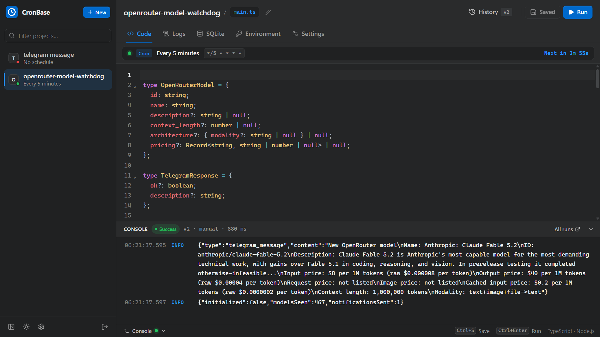

<p align="center">
  
</p>

<h1 align="center">CronBase</h1>

<p align="center">
  Self-hosted TypeScript script runner and scheduler with isolated SQLite databases and environment variables.
</p>

<p align="center">
  <a href="https://github.com/bariskisir/CronBase/actions/workflows/release.yml"></a>
  <a href="https://github.com/bariskisir/CronBase/tags"></a>
  <a href="https://hub.docker.com/r/bariskisir/cronbase"></a>
  <a href="https://github.com/bariskisir/CronBase/blob/master/LICENSE"></a>
</p>

<p align="center">
  With <strong>val.town</strong> shutting down on <strong>January 10, 2027</strong>, CronBase is built from the ground up using a clean-room approach as a lightweight, self-hosted alternative to migrate and run your scheduled TypeScript projects.
</p>

<p align="center">
  
</p>

---

## Docker

```bash
docker run -d --name cronbase --restart unless-stopped -p 3000:3000 -v cronbase_data:/app/data -v cronbase_logs:/app/logs bariskisir/cronbase
```

## Source Code

- GitHub: [https://github.com/bariskisir/CronBase](https://github.com/bariskisir/CronBase)
